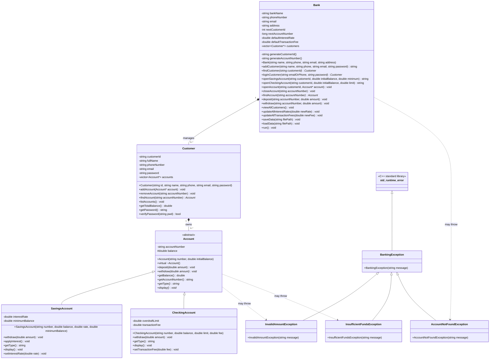

# DEU Bank — C++ Bank Account Manager

OOP II team project. A command-line banking system with savings and checking accounts.

## Run

On Mac/Linux, open a terminal in the project folder:

```bash
g++ -std=c++17 -Wall -Wextra -Iinclude src/*.cpp -o bank_app
./bank_app
```

On Windows (MinGW):

```bash
g++ -std=c++17 -Wall -Wextra -Iinclude src/*.cpp -o bank_app.exe
.\bank_app.exe
```

## Admin login

- Bank name: `deu`
- Password: `admin`

## Customer registration

Enter a full name, the **last eight digits** of a Korean mobile number (the program adds `010`), an email address, and a password.

The program rejects empty or spaces-only answers, bad phone numbers, malformed emails, and invalid menu/amount entries. It also checks for existing email/phone registrations.

## Saving data

There is no manual Save menu option. The application automatically writes to `bank_data.txt` after registration, account creation/closure, deposits, withdrawals, interest updates and fee updates, and when exiting normally. Saved data loads on the next run.

**If you have an existing `bank_data.txt`, keep it in the project folder** to retain saved customers and accounts. The download intentionally does not include personal data.

## UML Class Diagram



## Code files

- `include/` — class definitions
- `src/` — implementation and menus
- `uml.mmd` — final UML diagram

The project keeps OOP inheritance, polymorphism, exceptions and file I/O. Input is handled directly inside the menus rather than via separate `readLine`, `readInt`, or `readDouble` functions.

**Class project only:** Customer passwords are stored as plain text in `bank_data.txt`, and the admin password is fixed. This is not suitable for real financial accounts.
