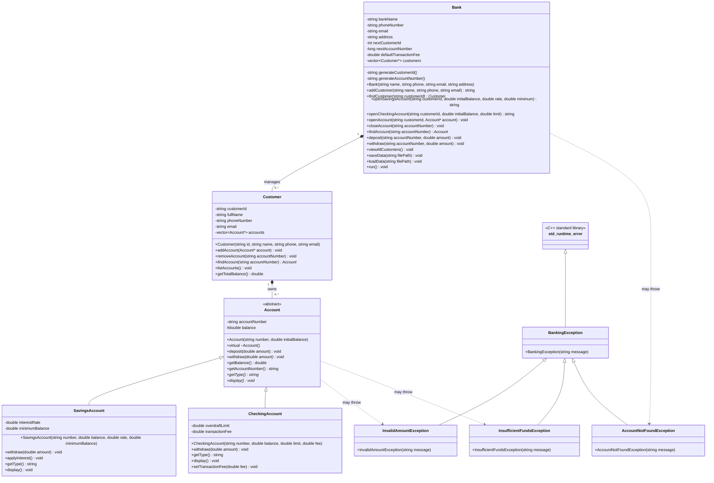

# Bank Account Manager

A console-based **Bank Account Manager** built in C++17 for the **OOP II** final project. The application provides separate Bank Manager and Customer roles, auto-generates customer IDs and account numbers, supports savings and checking accounts, and persists all bank data between runs.

## Project Information

| Item | Detail |
| --- | --- |
| Project | Bank Account Manager (CLI) |
| Course | OOP II |
| Instructor | Professor Asrat Kaleab Taye |
| Language | C++17 |
| Toolchain | g++ |
| Version | 1.1.0 |

## Team Credits

| Team member | Role | Responsibilities |
| --- | --- | --- |
| [Team Member 1] | Team lead / architect | Class design, integration, build |
| [Team Member 2] | Developer | Account types, transactions |
| [Team Member 3] | Developer / QA | CLI flows, testing, documentation |

> Replace the placeholder names and roles with the actual team members before submission.

## Project Overview

`Bank` owns customers through `Customer*` pointers, and each customer owns accounts through `Account*` pointers. Customers are assigned automatic 4-digit IDs starting at `1001`, and accounts receive automatic 8-digit numbers starting at `10000001`. Checking accounts use a default transaction fee of `2.0`, which the Bank Manager can update for future accounts or an existing checking account.

## OOP Design Summary

- **Encapsulation:** State such as customer lists, account balances, ID counters, and the default transaction fee is private or protected and accessed through public operations.
- **Inheritance:** `SavingsAccount` and `CheckingAccount` publicly inherit from `Account`.
- **Abstraction:** `Account` is abstract and declares `withdraw()`, `getType()`, and `display()` as pure virtual functions.
- **Runtime polymorphism:** Accounts are managed as `Account*`; virtual dispatch selects the correct withdrawal, interest, and display behavior.
- **Custom exceptions:** `BankingException` derives from `std::runtime_error`, with `InvalidAmountException`, `InsufficientFundsException`, and `AccountNotFoundException` as derived types.
- **File I/O:** `Bank::saveData()` and `Bank::loadData()` use `<fstream>`, `getline`, `find`, and `substr` to persist customers, accounts, balances, and account-specific settings.
- **Memory ownership:** Raw pointers are used exclusively. `~Bank()` deletes its customers and `~Customer()` deletes its accounts.

## CLI Features

### Main Menu

```text
1) Login as Bank Manager
2) Register / Login as Customer
0) Save & Exit
```

### Bank Manager Menu

```text
1) Add New Customer
2) Open Savings Account for Customer
3) Open Checking Account for Customer
4) View Customer Accounts & Total Balance
5) Apply Interest to Savings Account
6) Close Customer Account
7) View All Customers & Accounts
8) Update Checking Transaction Fee
0) Logout to Main Menu
```

Manager credentials are displayed on the login screen:

```text
Bank Name: DEU Bank
Password:  admin123
```

### Customer Portal

```text
1) Register as New Customer
2) Login as Existing Customer
0) Back to Main Menu
```

New customers are assigned an ID automatically and taken directly to their dashboard. Existing customers log in with their customer ID and matching email or phone number.

### Customer Dashboard

```text
1) View My Accounts & Total Balance
2) Deposit
3) Withdraw
4) Open Savings Account
5) Open Checking Account
0) Logout to Main Menu
```

Customer deposits and withdrawals verify account ownership through `Customer::findAccount()` before performing the transaction. Input helpers handle invalid numeric entries without skipping later `getline` input, and all actions are protected by exception handling.

## Project Structure

```text
bank-account-manager/
|-- include/
|   |-- Account.h
|   |-- Bank.h
|   |-- CheckingAccount.h
|   |-- Customer.h
|   |-- Exceptions.h
|   `-- SavingsAccount.h
|-- src/
|   |-- Account.cpp
|   |-- Bank.cpp
|   |-- CheckingAccount.cpp
|   |-- Customer.cpp
|   |-- SavingsAccount.cpp
|   `-- main.cpp
|-- .gitignore
|-- README.md
`-- uml.mmd
```

`bank_data.txt` is generated at runtime and is excluded from version control.

## System Architecture & UML Diagram



## Build and Run

### Prerequisites

- g++ with C++17 support
- A terminal (PowerShell, Bash, etc.)

### Compile

From the project root:

```bash
g++ -std=c++17 -Wall -Wextra -Iinclude src/*.cpp -o bank_app
```

### Run

```bash
./bank_app
```

On Windows PowerShell, the executable may also be launched with:

```bash
./bank_app.exe
```

`bank_data.txt` is loaded automatically on startup when present, and saved on every exit path. A missing data file is handled gracefully.

## Persistence Format

`bank_data.txt` stores one pipe-delimited record per line. Spaces in names and addresses are preserved.

```text
BANK|DEU Bank|02-123-4567|bank@example.com|123 Main Street, Seoul
CUSTOMER|1001|Alice Smith|010-1111-2222|alice@example.com
SAVINGS|10000001|1050|0.05|100
CHECKING|10000002|200|300|3
```

On load, the bank scans all saved customer IDs and account numbers and continues generation from the highest loaded value plus one, preventing collisions with saved records.

## Verification Checklist

- [x] Clean C++17 build with `-Wall -Wextra` and zero warnings
- [x] Raw pointer ownership with `new`/`delete`; no smart pointers
- [x] Abstract `Account` with pure virtual functions and virtual destructor
- [x] Custom exception hierarchy derived from `std::runtime_error`
- [x] Automatic 4-digit customer IDs and 8-digit account numbers
- [x] ID and account-number generation continues correctly after `loadData()`
- [x] Default checking transaction fee is applied automatically
- [x] Manager can update the default fee and optionally an existing checking account
- [x] Admin view-all panel lists every customer and all owned accounts
- [x] Customer ownership checks prevent accessing another customer's account
- [x] Input validation and exception handling prevent crashes and input skipping
- [x] End-to-end test verified generated IDs `1001`–`1004` and account numbers `10000001`–`10000006`
- [x] End-to-end test verified saved balances and checking fees after restart

## Notes

- Build artifacts and `bank_data.txt` are excluded by `.gitignore`.
- Replace the team-credit placeholders before submitting the project.
