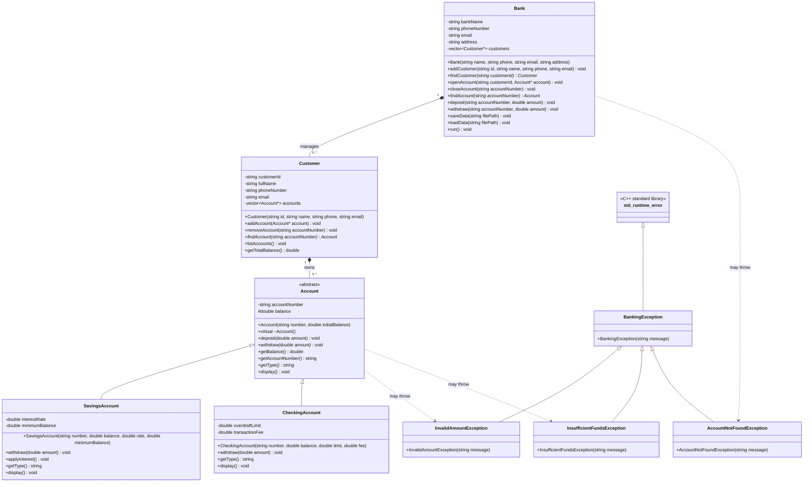

# Bank Account Manager

A console-based **Bank Account Manager** built in C++17 for the **OOP II** final project. The application supports customer registration, savings and checking accounts, deposits, withdrawals, interest application, account closing, and persistent data storage.

## Project Information

| Item | Detail |
| --- | --- |
| Project | Bank Account Manager (CLI) |
| Course | OOP II |
| Instructor | Professor Asrat Kaleab Taye |
| Language | C++17 |
| Toolchain | g++ |
| Version | 1.0.0 |

## Team Credits

| Team member | Role | Responsibilities |
| --- | --- | --- |
| [Team Member 1] | Team lead / architect | Class design, integration, build |
| [Team Member 2] | Developer | Account types, transactions |
| [Team Member 3] | Developer / QA | CLI flows, testing, documentation |

> Replace the placeholder names and roles with the actual team members before submission.

## Project Overview

The system models a bank as an owner of customers, and each customer as an owner of accounts. All account objects are handled through `Account*` pointers so that withdrawals, interest application, and display operations use runtime polymorphism. Data is saved to and restored from a plain-text file so balances survive application restarts.

## OOP Design Summary

- **Encapsulation:** Class state is private or protected (`Bank::customers`, `Customer::accounts`, `Account::accountNumber`, `Account::balance`) and is accessed through public operations.
- **Inheritance:** `SavingsAccount` and `CheckingAccount` publicly inherit from `Account` and implement its pure virtual interface.
- **Abstraction:** `Account` is abstract. It defines `withdraw()`, `getType()`, and `display()` as pure virtual functions and provides a virtual destructor.
- **Runtime polymorphism:** `Bank` and `Customer` store `Account*` pointers; virtual dispatch selects the correct withdrawal and display behavior for each account type.
- **Custom exceptions:** `BankingException` derives from `std::runtime_error`, with `InvalidAmountException`, `InsufficientFundsException`, and `AccountNotFoundException` deriving from it.
- **File I/O:** `Bank::saveData()` and `Bank::loadData()` use `<fstream>`, `std::getline`, `find`, and `substr` to persist and restore customers and both account types.
- **Memory ownership:** Raw pointers are used throughout. `~Bank()` deletes its `Customer*` objects and `~Customer()` deletes its `Account*` objects. No smart pointers are used.

## CLI Features

```text
1) Add Customer
2) Open Savings Account
3) Open Checking Account
4) Deposit
5) Withdraw
6) View Customer Accounts & Total Balance
7) Apply Interest (Savings)
8) Close Account
0) Save & Exit
```

The menu validates numeric input, re-prompts after invalid entries, and reports all banking errors through the custom exception hierarchy without terminating the application. Customer names, phone numbers, emails, and bank addresses may contain spaces.

## Project Structure

```text
bank-account-manager/
|-- include/
|   |-- Account.h
|   |-- Bank.h
|   |-- CheckingAccount.h
|   |-- Customer.h
|   |-- Exceptions.h
|   `-- SavingsAccount.h
|-- src/
|   |-- Account.cpp
|   |-- Bank.cpp
|   |-- CheckingAccount.cpp
|   |-- Customer.cpp
|   |-- SavingsAccount.cpp
|   `-- main.cpp
|-- .gitignore
|-- README.md
`-- uml.mmd
```

`bank_data.txt` is generated at runtime and is intentionally excluded from version control.

## System Architecture & UML Diagram



## Build and Run

### Prerequisites

- g++ with C++17 support
- A terminal (PowerShell, Bash, etc.)

### Compile

From the project root:

```bash
g++ -std=c++17 -Wall -Wextra -Iinclude src/*.cpp -o bank_app
```

### Run

```bash
./bank_app
```

On Windows PowerShell, the executable may also be launched with:

```bash
./bank_app.exe
```

The application loads `bank_data.txt` on startup when it exists, runs the interactive menu, and saves all data when the application exits. On first launch, a missing data file is handled gracefully and the bank starts empty.

## Persistence Format

`bank_data.txt` uses one pipe-delimited record per line:

```text
BANK|OOP II Bank|02-123-4567|bank@example.com|123 Main Street, Seoul
CUSTOMER|C101|Mina Park|010-1234-5678|mina@example.com
SAVINGS|SAV-1001|1575|0.05|100
CHECKING|CHK-2001|95|300|5
```

Fields may contain spaces. The loader uses `std::getline`, `find`, and `substr`, and rebuilds every customer and account with its original balance and type-specific parameters.

## Verification Checklist

- [x] Clean C++17 build: `g++ -std=c++17 -Wall -Wextra -Iinclude src/*.cpp -o bank_app`
- [x] Raw pointer ownership with `new`/`delete`; no smart pointers
- [x] Abstract `Account` with pure virtual functions and virtual destructor
- [x] Custom exception hierarchy derived from `std::runtime_error`
- [x] Input validation prevents failed numeric reads and skipped `getline` input
- [x] Save/load preserves customers, account types, balances, and spaces in text fields
- [x] End-to-end CLI test: savings balance `1575`, checking balance `95`, total balance `1670` after restart
- [x] Invalid withdrawal displays `Error: Insufficient funds.` without crashing

## Notes

- Build artifacts and `bank_data.txt` are excluded by `.gitignore`.
- Replace the team-credit placeholders before submitting the project.
