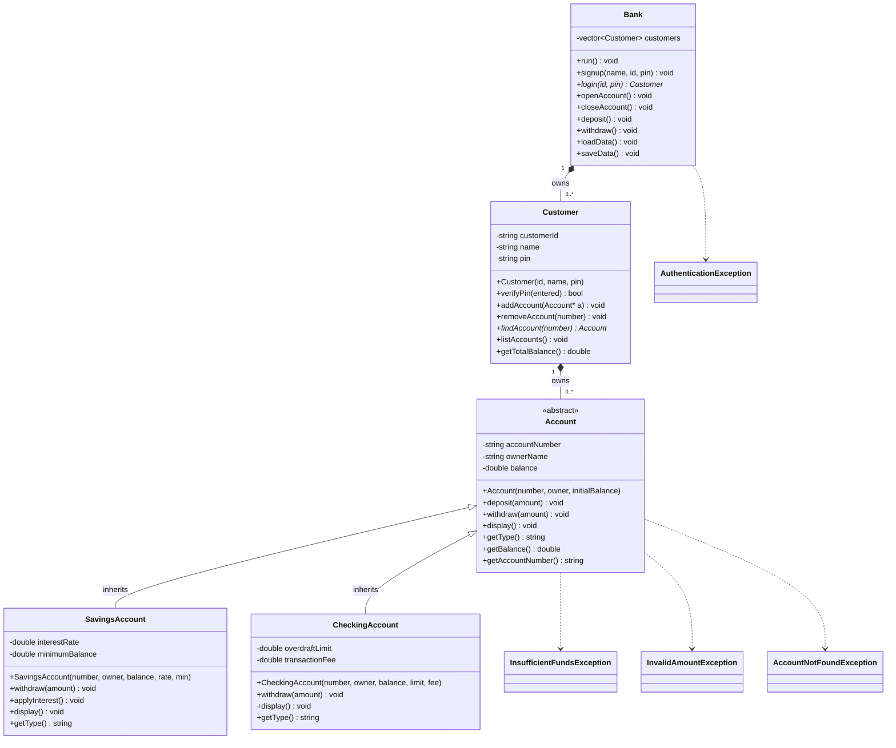

# Bank Account Manager

A console-based **Bank Account Manager** written in C++ for the **OOP II** final project. The system models bank accounts through an abstract base class and a polymorphic command-line interface.

## Project Information

| Item | Detail |
| --- | --- |
| Project | Bank Account Manager (CLI) |
| Course | OOP II |
| Language | C++ (C++11 or later) |
| Toolchain | g++ |
| Current version | 0.6.0 - customer PIN and accounts |

## Team Credits

| Team member | Role | Responsibilities |
| --- | --- | --- |
| [Team Member 1] | Team lead / architect | Class design, integration, build |
| [Team Member 2] | Developer | Account types, transactions |
| [Team Member 3] | Developer / QA | CLI flows, testing, documentation |

> Replace the placeholder names and roles with the actual team members before submission.

## Requirements Checklist

### Foundation

- [x] Abstract `Account` base class in `include/Account.h`
- [x] Protected state: `accountNumber`, `holderName`, `balance`
- [x] Pure virtual `deposit(double)`, `withdraw(double)`, `displayInfo()`
- [x] Virtual destructor for safe polymorphic deletion
- [x] Interactive "Bank Account Manager" CLI welcome banner
- [x] Header inclusion verified at compile time
- [x] Clean build with `g++ -Iinclude src/main.cpp -o bank_app`

### Savings account milestone

- [x] `SavingsAccount` inherits publicly from `Account`
- [x] Private `interestRate` member stored as a decimal fraction
- [x] Constructor initialises the base state through an initializer list
- [x] `addInterest()` compounds interest into the balance
- [x] `displayInfo()` override reports savings details and interest rate
- [x] `deposit()` and `withdraw()` overrides satisfy the pure virtual API
- [x] Runtime test: `Mina`, balance `1000.00`, rate `0.05` displays `1050.00`

### Checking account milestone

- [x] `CheckingAccount` inherits publicly from `Account`
- [x] Private `overdraftLimit` member
- [x] Constructor initialises the base state through an initializer list
- [x] `withdraw()` allows `(balance - amount) >= -overdraftLimit` for positive amounts
- [x] `displayInfo()` override reports checking details and overdraft limit
- [x] `deposit()` override satisfies the pure virtual API
- [x] Runtime test: `Jin`, balance `200.00`, limit `300.00`; a `400.00` withdrawal reaches `-200.00`

### Custom exception milestone

- [x] `InsufficientFundsException` inherits publicly from `std::exception`
- [x] Stores the requested amount and current balance as private members
- [x] Constructor initialises both fields through an initializer list
- [x] `what()` is `const`, `noexcept`, and overrides the base method
- [x] `getRequestedAmount()` and `getCurrentBalance()` accessors
- [x] `SavingsAccount::withdraw()` throws when the amount exceeds the balance
- [x] `CheckingAccount::withdraw()` throws when the overdraft limit would be exceeded
- [x] `main()` catches the exception and prints `what()`, requested amount, and balance
- [x] Runtime test: a second `200.00` withdrawal from `Jin` is caught with a `-200.00` balance

### Bank manager milestone

- [x] `Bank` stores accounts in `std::vector<Account*>`
- [x] `addAccount(Account*)` transfers ownership to the bank
- [x] `showAllAccounts() const` calls `displayInfo()` through base pointers
- [x] `findAccount(ownerName)` returns the matching account or `nullptr`
- [x] `~Bank()` deletes every owned account
- [x] Copy construction and assignment are disabled to prevent double deletion
- [x] `Account::getHolderName()` provides read-only lookup access
- [x] Runtime test: dynamically allocated savings and checking accounts displayed polymorphically
- [x] Runtime test: `findAccount("Mina")` followed by a `500.00` deposit updates the balance to `1500.00`
- [x] Runtime test: `findAccount("Unknown")` returns `nullptr`

### Customer milestone

- [x] `Customer` stores `customerId`, `name`, `pin`, and `std::vector<Account*>`
- [x] Constructor initialises the identity fields through an initializer list
- [x] `verifyPin(enteredPin)` compares the supplied PIN with the stored PIN
- [x] `addAccount(Account*)` transfers account ownership to the customer
- [x] `findAccount(accountNumber)` returns the matching account or `nullptr`
- [x] `listAccounts() const` calls `displayInfo()` polymorphically
- [x] `getTotalBalance() const` sums all owned account balances
- [x] `~Customer()` deletes every owned account; copying is disabled
- [x] `Account::getAccountNumber()` and `Account::getBalance()` support lookup and totals
- [x] Runtime test: `C101` / `Mukhsinjon` / PIN `1234`; correct PIN accepted, wrong PIN rejected, total balance `2000.00`

### Planned milestones

- [ ] Bank-level customer management (signup, login, customer-owned accounts)
- [ ] Interactive account creation, lookup, listing, and closing
- [ ] Deposit/withdraw flows with interactive input
- [ ] Transaction history and reporting
- [ ] Persistent storage (load/save accounts)
- [ ] Additional validation exceptions (invalid amounts, rates)
- [ ] Final UML diagram, report, and demo

## Project Structure

```text
bank-account-manager/
|-- include/
|   |-- Account.h                    # Abstract base class
|   |-- SavingsAccount.h             # Interest-bearing concrete account
|   |-- CheckingAccount.h            # Overdraft-enabled concrete account
|   |-- InsufficientFundsException.h # Custom withdrawal exception
|   |-- Bank.h                       # Owns accounts through Account pointers
|   `-- Customer.h                   # Customer PIN and account ownership
|-- src/
|   `-- main.cpp                     # CLI entry point and account smoke tests
|-- .gitignore
`-- README.md
```

## System Architecture & UML Diagram



## Build and Run

### Prerequisites

- g++ with C++11 support or newer
- A terminal (PowerShell, Bash, etc.)

### Compile

From the project root:

```bash
g++ -Iinclude src/main.cpp -o bank_app
```

`-Iinclude` adds the `include/` directory to the header search path, so project headers resolve no matter which directory the compiler is invoked from.

### Run

```bash
./bank_app        # Linux / macOS / PowerShell / Git Bash
bank_app.exe      # Windows PowerShell or CMD
```

The current smoke test exercises the concrete account types, the exception path, the bank manager, and the customer:

- `SavingsAccount("Mina", 1000.0, 0.05)` applies one interest posting and prints `1050.00`.
- `CheckingAccount("Jin", 200.0, 300.0)` allows a `400.00` withdrawal down to `-200.00`.
- A further `200.00` withdrawal throws `InsufficientFundsException`; `main()` catches it and prints the message and account details.
- `Bank` owns dynamically allocated savings and checking accounts, displays them polymorphically, finds `Mina`, deposits `500.00`, and reports an unknown-owner lookup as `nullptr`.
- `Customer("C101", "Mukhsinjon", "1234")` verifies a correct and an incorrect PIN, owns a savings and checking account, lists them polymorphically, and reports a total balance of `2000.00`.

### Recommended strict build (optional)

```bash
g++ -std=c++14 -Wall -Wextra -pedantic -Iinclude src/main.cpp -o bank_app
```

## Design Notes

- `Account` is abstract: it defines the contract but cannot be instantiated.
- A protected `Account` constructor lets derived constructors initialise `accountNumber`, `holderName`, and `balance` through an initializer list.
- Data members are `protected` so derived account types can manage state while clients use only the public API.
- `SavingsAccount` stores its rate as a decimal fraction (`0.05` means 5%) and applies `balance += balance * interestRate` in `addInterest()`.
- `CheckingAccount` permits negative balances down to `-overdraftLimit`; a withdrawal is accepted only when `amount > 0` and `(balance - amount) >= -overdraftLimit`.
- Over-limit withdrawals throw `InsufficientFundsException`, which carries the requested amount and the balance at the time of the failure.
- `Bank` takes ownership of accounts added through `addAccount()`. Its destructor deletes each pointer, and its virtual base-class destructor ensures the derived destructor runs.
- `Bank` copying is disabled because duplicating the raw pointers would lead to double deletion.
- `Customer` also takes ownership of accounts added through `addAccount()` and deletes them in `~Customer()`. Do not add the same `Account*` to both a `Bank` and a `Customer`, because that would cause a double deletion.
- `Customer` stores its PIN privately and exposes only `verifyPin()`; the PIN itself is never returned by an accessor.
- `Customer` copying is disabled for the same raw-pointer ownership reason as `Bank`.
- Account numbers are generated as `SAV-1001`, `CHK-2001`, and so on.
- The virtual destructor guarantees that deleting a derived account through an `Account*` runs the full destructor chain.

## Next Steps

1. Refactor `Bank` to own `Customer` objects and delegate account operations, matching the UML.
2. Replace the banner-only flow with an interactive account-management menu.
3. Add interactive account creation, lookup, listing, and closing with PIN login.
4. Catch and report exceptions in the menu's withdrawal flow.
5. Add transaction records and file persistence.
